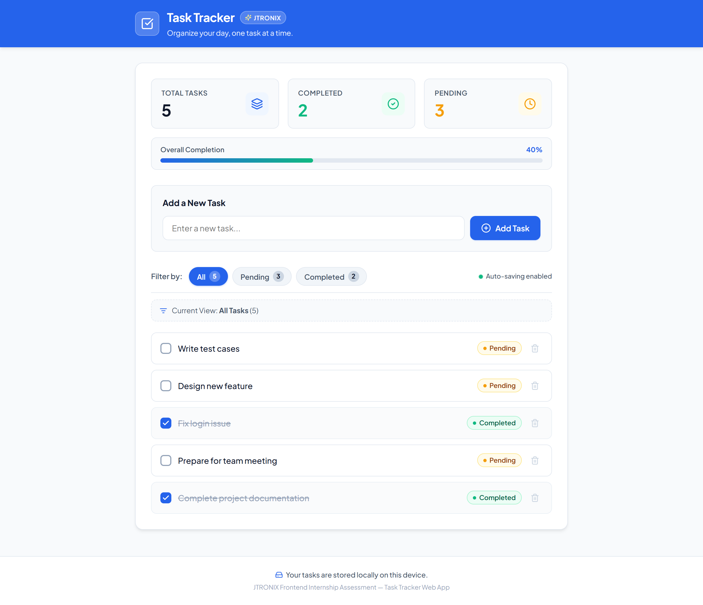
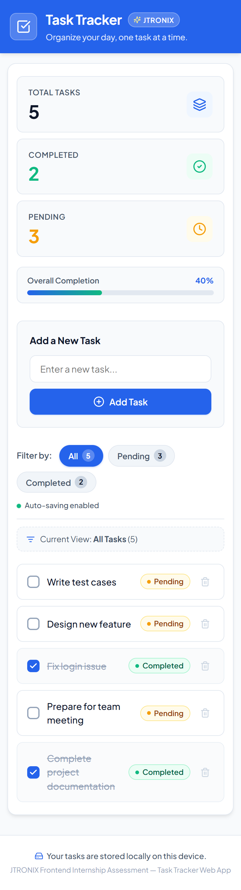

# Task Tracker — JTRONIX Frontend Internship Assessment

A modern, responsive, production-quality Task Tracker web application built with **React.js**, **Vite**, and **Lucide React**. This application satisfies 100% of the requirements specified in the JTRONIX Frontend Internship Assessment, providing real-time task management, status toggling, dynamic statistics, multi-criteria filtering, and robust `localStorage` persistence.

---

## 1. Project Title
**JTRONIX Task Tracker (Frontend Internship Assessment)**

---

## 2. Project Overview
The Task Tracker application is an intuitive, distraction-free productivity dashboard designed to help users capture, organize, and monitor daily tasks. Built as a single-page application (SPA), it operates entirely client-side without external backend dependencies, ensuring instant reactivity, offline readiness, and continuous data persistence through browser `localStorage`.

---

## 3. Objectives
- Deliver a robust, bug-free implementation of all three assessment stages (Questions 1.1, 1.2, and 1.3) within a unified React application.
- Emphasize best practices in React architecture: functional components, React Hooks (`useState`, `useEffect`, `useMemo`), unidirectional data flow, and immutable state updates.
- Create an aesthetically pleasing, accessible, and responsive user interface aligned with the assessment design mockups.
- Safeguard user data with comprehensive validation, input sanitization, and resilient storage serialization.

---

## 4. Features Implemented

### Task Creation & Input Validation (Question 1.1)
- **Instant Task Addition:** Tasks are created and displayed immediately in the list without page reload.
- **Form Controls:** Clean input field with submit button and keyboard submission support (`Enter` key).
- **Whitespace Sanitization:** Automatically trims leading and trailing whitespace from input text.
- **Empty Task Prevention:** Rejects empty or whitespace-only submissions.
- **User Feedback:** Displays an inline validation message when invalid submissions are attempted, which auto-dismisses as the user starts typing.
- **Input Reset:** Automatically clears the input field upon successful task creation.

### Task Management & Dynamic Counters (Question 1.2)
- **Status Lifecycle:** Every task carries a strict status: `Pending` or `Completed` (new tasks default to `Pending`).
- **Interactive Status Toggle:** Checkbox and status badges allow toggling between pending and completed states at any time.
- **Visual Distinction:** Completed tasks feature subtle strikethrough typography and muted slate coloring.
- **Status Badges:** Distinctive color-coded badges for quick identification (Emerald for `Completed`, Amber for `Pending`).
- **Instant Task Deletion:** Trash action button immediately deletes tasks from both state and storage.
- **Live Statistics:** Real-time counters calculate:
  - **Total Tasks**
  - **Completed Tasks**
  - **Pending Tasks**
  - **Overall Completion Progress Bar**

### Filtering & Persistent Storage (Question 1.3)
- **Multi-State Filtering:** Filter tabs for **All**, **Pending**, and **Completed** tasks.
- **Badge Indicators:** Filter tabs dynamically display the count of matching items.
- **Current View Banner:** Clarifies the active filter context to the user.
- **Auto-Saving via LocalStorage:** State automatically synchronizes with browser `localStorage`.
- **Session Restoration:** Tasks and statuses persist across page refreshes and browser restarts.
- **Fault-Tolerant Storage Utility:** Protects against corrupted, malformed, or missing localStorage payloads.
- **Adaptive Empty States:** Contextual messages when no tasks exist or when a filter yields zero matches.

---

## 5. Technology Stack

| Technology | Purpose |
| :--- | :--- |
| **React 18** | Component architecture, state hooks, and virtual DOM reconciliation |
| **Vite 5** | High-performance bundling, development server, and build pipeline |
| **JavaScript (ES Modules)** | Core client-side application logic |
| **HTML5 & CSS3** | Semantic markup, custom styling, Flexbox/Grid layouts, and CSS variables |
| **Lucide React** | Clean, accessible iconography |
| **HTML5 Web Storage API** | Browser `localStorage` for offline data persistence |

---

## 6. Screenshots

### Desktop View


### Mobile View


---

## 7. Project Folder Structure

```
task-tracker/
├── public/
│   └── favicon.svg               # SVG brand checkmark favicon
├── screenshots/
│   ├── desktop-view.png          # High-resolution desktop application screenshot
│   └── mobile-view.png           # Mobile responsive application screenshot
├── scripts/
│   └── test-and-capture.mjs      # Automated end-to-end verification and screenshot capture script
├── src/
│   ├── components/
│   │   ├── EmptyState.jsx        # Context-aware empty state feedback
│   │   ├── Header.jsx            # Application header and branding banner
│   │   ├── TaskFilters.jsx       # Filter tabs, counts, and view banner
│   │   ├── TaskForm.jsx          # Task input form with validation
│   │   ├── TaskItem.jsx          # Individual task row with toggle and delete
│   │   ├── TaskList.jsx          # Task container list
│   │   └── TaskStats.jsx         # Summary cards and completion progress
│   ├── utils/
│   │   └── storage.js            # Safe localStorage load/save and UUID generation
│   ├── App.jsx                   # Root application component and state orchestration
│   ├── index.css                 # Global styles, variables, typography, and responsive rules
│   └── main.jsx                  # React application entry point
├── index.html                    # Root HTML template with typography imports
├── package.json                  # Project dependencies and operational scripts
├── package-lock.json             # Locked dependency versions
├── vite.config.js                # Vite build and development configuration
├── .gitignore                    # Version control ignore definitions
└── README.md                     # Comprehensive documentation
```

---

## 8. Prerequisites

Ensure your system meets the following software requirements:
- **Node.js:** `v18.0.0` or later (tested on `v24.12.0`)
- **npm:** `v9.0.0` or later (tested on `11.1.0`)
- A modern web browser: Google Chrome, Mozilla Firefox, Microsoft Edge, or Safari.

Check your current installation:
```bash
node -v
npm -v
```

---

## 9. Installation Instructions

1. Clone or extract the project repository to your local directory.
2. Open a terminal in the project directory.
3. Install all dependencies:
```bash
npm install
```

---

## 10. How to Start the Development Server

To launch the local development server with Hot Module Replacement (HMR):
```bash
npm run dev
```
Once started, navigate to the local URL displayed in the terminal (typically `http://localhost:5173`).

---

## 11. How to Build the Application for Production

To create an optimized production build:
```bash
npm run build
```
The compiled, minified bundle will be generated inside the `dist/` directory.

---

## 12. How to Preview the Production Build

To test and preview the production build locally:
```bash
npm run preview
```
Open the provided URL (typically `http://localhost:4173`) in your browser to verify the production build behavior.

---

## 13. Instructions for Using the Application

1. **Adding a Task:**
   - Type your task description into the "Enter a new task..." field.
   - Click the **Add Task** button or press `Enter`.
   - Your task will immediately appear at the top of the list in `Pending` status.
2. **Marking a Task as Completed or Pending:**
   - Click the checkbox or the status pill badge next to the task text.
   - The status immediately switches between `Pending` and `Completed`.
   - Completed tasks display a strikethrough with muted text styling.
3. **Deleting a Task:**
   - Click the red trash icon on the right side of the task card.
   - The task is immediately deleted from the interface and storage.
4. **Filtering Tasks:**
   - Click **All** to view every task.
   - Click **Pending** to view only uncompleted tasks.
   - Click **Completed** to view only finished tasks.
   - Filter count badges automatically reflect current numbers.
5. **Persistence Verification:**
   - Add several tasks, modify statuses, or delete items.
   - Refresh the browser (`F5` or `Ctrl + R`).
   - Notice that your tasks and counts persist intact.

---

## 14. Explanation of Task Statuses and Filters

- **Task Statuses:**
  - `Pending`: Denotes active tasks that require action. Styled with an amber pill badge (`#F59E0B`).
  - `Completed`: Denotes finished tasks. Styled with an emerald pill badge (`#10B981`) and strikethrough text.
- **Filter Views:**
  - **All:** Displays every task regardless of status.
  - **Pending:** Restricts view strictly to items with status `Pending`.
  - **Completed:** Restricts view strictly to items with status `Completed`.
  - **Derived Counts:** Rather than maintaining duplicate state, filter counters and statistic cards are computed dynamically from the single source of truth in state, guaranteeing synchronization.

---

## 15. Explanation of How LocalStorage Persistence Works

1. **Initialization:** On initial load, `loadTasksFromStorage()` retrieves data from the key `jtronix_task_tracker_data_v1`.
2. **Schema Sanitization:** The stored string is parsed using `JSON.parse()`. If valid, each task object is validated to ensure it has a valid `id`, trimmed `text`, valid `status` (`'Pending'` | `'Completed'`), and timestamp. Corrupted or invalid items are safely discarded.
3. **State Synchronization:** A React `useEffect` hook monitors the `tasks` state. Whenever a task is added, updated, or removed, `saveTasksToStorage(tasks)` serializes the updated array to `localStorage`.
4. **Graceful Error Handling:** If `localStorage` is disabled (e.g. private browsing storage quota) or throws an exception, errors are caught in `try...catch` blocks to prevent application crashes.

---

## 16. Browser Compatibility Notes

The application uses standard web technologies and modern CSS variables, supporting:
- **Google Chrome:** Version 90+
- **Mozilla Firefox:** Version 90+
- **Microsoft Edge:** Version 90+
- **Apple Safari:** Version 14+
- **Mobile Browsers:** Chrome for Android, Safari on iOS, Samsung Internet.

---

## 17. Assessment Requirement Checklist

| Requirement | Question | Status | Implementation Details |
| :--- | :--- | :---: | :--- |
| Provide text box & Add button | Q1.1 | Passed | Implemented in `TaskForm.jsx` with input field and submit button |
| Display task immediately in list | Q1.1 | Passed | Immutable state update in `App.jsx` prepends task instantly |
| Prevent empty / whitespace tasks | Q1.1 | Passed | Validated with `.trim()`, blocking empty submissions |
| Trim whitespace on submission | Q1.1 | Passed | Trims input value before saving |
| Support Enter key submission | Q1.1 | Passed | Form utilizes `onSubmit` with native keyboard event support |
| Clear input after submission | Q1.1 | Passed | Resets `taskText` state upon successful submission |
| Helpful validation message | Q1.1 | Passed | Renders accessible inline error message with warning icon |
| Mark as Completed or Pending | Q1.2 | Passed | Checkbox and clickable status pill toggle status dynamically |
| Default new tasks to Pending | Q1.2 | Passed | New tasks are instantiated with `status: 'Pending'` |
| Strikethrough & subtle color change | Q1.2 | Passed | CSS class `.text-strikethrough` with line-through and muted slate color |
| Delete button for each task | Q1.2 | Passed | Trash icon button on each task card |
| Immediate deletion from interface | Q1.2 | Passed | Filters out task by ID immutably |
| Display total number of tasks | Q1.2 | Passed | Calculated dynamically via `tasks.length` in `TaskStats.jsx` |
| Display number of completed tasks | Q1.2 | Passed | Derived via `.filter(t => t.status === 'Completed').length` |
| Display number of pending tasks | Q1.2 | Passed | Derived via `totalCount - completedCount` |
| Update counts immediately | Q1.2 | Passed | Reactive state recalculation ensures immediate updates |
| Filter options: All, Pending, Completed | Q1.3 | Passed | Filter tabs implemented in `TaskFilters.jsx` |
| Show task count per filter | Q1.3 | Passed | Dynamic count badges rendered within each filter button |
| Persist to browser `localStorage` | Q1.3 | Passed | Handled in `storage.js` and synchronized via `useEffect` |
| Restore tasks upon reload/refresh | Q1.3 | Passed | Safe lazy initializer `useState(() => loadTasksFromStorage())` |
| Safe error handling for storage | Q1.3 | Passed | Schema validation with `try/catch` fallbacks |
| Responsive desktop & mobile layout | Q1.3 | Passed | Flexbox, CSS Grid, mobile media queries, zero horizontal scroll |

---

## 18. Troubleshooting Instructions

- **Port in use:** If port `5173` is occupied, Vite will automatically select the next available port (e.g. `5174`), or you can specify `--port <number>`.
- **Tasks not saving:** Verify that your browser has cookies and local storage enabled and is not running in an environment that restricts storage quota.
- **Node module issues:** Delete `node_modules` and run `npm install` to reinstall dependencies cleanly.

---

## 19. Limitations

- **Local Storage Scope:** Data is stored exclusively within the browser's `localStorage` on the current machine and profile. Tasks are not synchronized across different devices or separate browsers without a cloud backend.
- **Browser Storage Limits:** Typical browser `localStorage` capacity is approximately 5MB, which is more than sufficient for thousands of tasks but does not support large binary attachments.

---

## 20. Future Improvements

- Task categorization by tags or project folders (e.g., Work, Personal, Urgent).
- Due date reminders and calendar pickers.
- Drag-and-drop task reordering.
- Export and import functionality (JSON / CSV backup).
- Dark mode theme toggle.

---

## 21. Author
- **Candidate Name:** *[Your Name Here]*
- **Role Applied For:** Frontend Developer Intern — JTRONIX

---

## 22. Deployment
- **Live URL:** *[Optional: Add your deployed URL here, e.g. Vercel, Netlify, or GitHub Pages]*
- **Repository:** *[GitHub Repository Link]*
